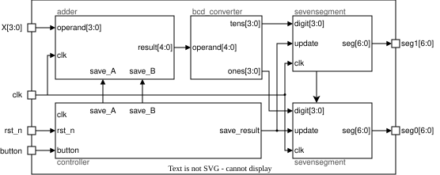
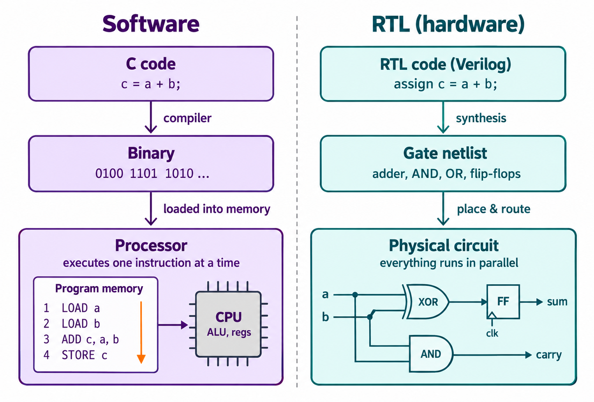
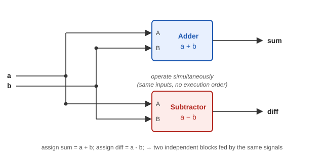
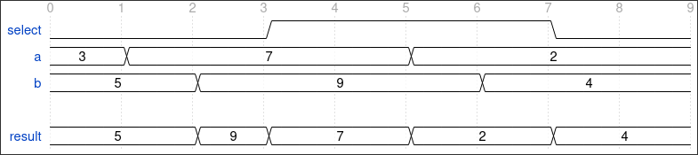
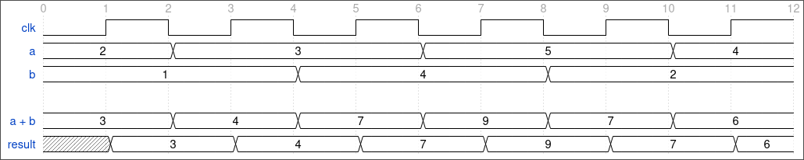

# RTL-Design

## 1. Introduction

### What is RTL Design?

Register Transfer Level (RTL) is an abstraction used to describe the behavior of synchronous digital circuits in terms of data processing, storage, and the transfer of information between registers.

Rather than specifying individual logic gates and their connections, RTL allows designers to describe a circuit at a higher level of abstraction using a Hardware Description Language (HDL), such as Verilog or SystemVerilog. The syntax of these languages is covered in [SystemVerilog](../systemverilog/index.md); this chapter focuses on the design concepts behind the code.

Unlike traditional software programming, where instructions are executed by a processor, RTL describes hardware that implements the specified functionality. This distinction is fundamental: hardware components can operate concurrently, signals represent connections between components, and registers store information synchronized by a clock.

For example, consider the following description:

```system-verilog
assign result = a + b;
```

This statement does not instruct a processor to perform an addition. Instead, it describes a combinational addition operation that can be implemented as an adder circuit.

Understanding the relationship between an RTL description and the hardware it represents is essential for designing digital circuits effectively.

### RTL in the Digital Design Flow

RTL design is an important stage in the development of digital integrated circuits.

The process typically begins with a set of specifications and requirements, defining what the circuit must accomplish and the constraints it must satisfy. For example:

> Design a small digital ASIC Chip implementing a mini adder controlled by a single button and a finite state machine (FSM). The system sequentially captures two 4-bit operands, computes their sum, and displays the result on two 7-segment displays. The control button is considered ideal, meaning it produces a single-clock-cycle pulse synchronized to clk.

Based on these requirements, designers develop a hardware architecture, identifying the functional components, their interfaces, and how they communicate. The resulting diagram from the previous specifications could be:



This architecture is then described using RTL. The top-level module below only instantiates and connects the blocks of the architecture (the language constructs used are explained in [SystemVerilog](../systemverilog/index.md)):

```system-verilog
module chip(
    input clk,
    input rst_n,
    input button,
    input [3:0] X,
    output [6:0] seg0,
    output [6:0] seg1
);

logic save_A;
logic save_B;
logic show_result;
logic [4:0] result;
logic [3:0] tens;
logic [3:0] ones;

controller u_ctrl(
    .clk(clk),
    .rst_n(rst_n),
    .button(button),
    .save_A(save_A),
    .save_B(save_B),
    .show_result(show_result)
);

//Rest of the implementations

endmodule
```

Note how the structure of the code mirrors the block diagram: each functional block becomes a module, and each connection between blocks becomes a signal.

Once the RTL implementation is complete, its functionality can be evaluated through simulation and other verification methods. The RTL can subsequently be synthesized into a gate-level netlist, which forms the basis for physical implementation.
A simplified representation of this process can be found on [Digital Flow](../digital_flow/index.md).

In practice, the process is iterative. Verification, synthesis, or physical implementation may reveal issues that require changes to the RTL or even the underlying architecture.
### Design Before Coding

One of the most important principles of RTL design is to think about the hardware before writing its description.

Writing RTL without a clear understanding of the intended architecture can lead to unnecessarily complex designs, incorrect functionality, and inefficient hardware implementations.

A systematic approach begins by identifying the functionality required by the specifications and representing it through functional block diagrams.

These diagrams help designers visualize the system, identify its main components, define inputs and outputs, establish signal widths, and understand how information flows between blocks.

For more complex systems, the same process can be applied hierarchically, decomposing functional blocks into smaller components.

Once the architecture is understood, RTL becomes a means of describing the intended hardware rather than discovering the design through coding.

## 2. Thinking in Hardware

Designing digital hardware requires a different way of thinking from traditional software programming.

In software, a program typically describes a sequence of instructions executed by a processor. In hardware design, however, we describe circuits composed of interconnected components that can operate simultaneously.



When writing RTL, the objective is not simply to describe an algorithm, but to describe the hardware that will implement it.

### Hardware vs. Software

Although HDLs such as Verilog and SystemVerilog resemble conventional programming languages, their underlying purpose is fundamentally different.

Consider a simple addition. In a conventional programming language:

```c
int result = a + b;
```

This statement describes an operation to be executed by a processor.
In SystemVerilog:

```system-verilog
assign result = a + b;
```

This statement describes a combinational relationship between the input signals a and b and the output signal result.
The hardware implementation may contain an adder circuit whose output changes in response to changes in its inputs.
The key difference is that the RTL description represents hardware functionality, rather than instructions that must be executed by a processor.

| Software Programming | RTL Design |
|---|---|
| Describes instructions executed by a processor. | Describes the structure and behavior of digital hardware. |
| Operations typically execute sequentially within a thread. | Hardware components can operate concurrently. |\\\
| Variables represent values stored in the program's execution environment. | Signals represent values within a hardware circuit. |
| Assignments update program variables. | Assignments describe combinational relationships or updates to hardware state. |
| Execution depends on the processor and runtime environment. | Behavior depends on the implemented circuit and its timing. |

These distinctions become especially important when working with concurrency, signals, and sequential logic.

### Concurrency

One of the most important characteristics of digital hardware is that multiple components can oper\ate simultaneously.

Consider the following description:

```system-verilog
assign sum  = a + b;
assign diff = a - b;
```

These two statements describe independent combinational operations. The resulting hardware can contain an adder and a subtractor operating in parallel, both receiving the same input signals. Unlike instructions in a sequential software program, the order in which these statements appear in the RTL does not determine the order of their execution. Both operations continuously respond to changes in their inputs. The following figure shows the resulting structure: both blocks receive the same inputs a and b, and each one produces its output independently.



This is a fundamental concept:

> RTL describes a collection of hardware components and their interactions, not a sequence of instructions executed one after another.

However, concurrency does not mean that every operation must be implemented using independent hardware.
Designers can intentionally share hardware resources, using multiplexers and control logic to select which operation should be performed.
Understanding these decisions is part of developing a hardware architecture.

### Signals and Connections

In digital hardware, components communicate through electrical connections that carry information.

At the RTL level, these connections are represented using signals. For example, in:

```system-verilog
assign b = a;
```

the signal `b` simply follows the value of `a`. This is a connection, not an operation that copies a value into a new storage location, as might happen in software.

#### Signals and buses
 
Signals can represent individual bits or groups of bits, commonly called buses. For example, a design may contain:
 
- A single-bit enable signal.
- An 8-bit data bus.
- A 4-bit address bus.

Signal widths are particularly important in hardware design because they determine how many bits are represented and influence the hardware resources required.
For instance, an 8-bit adder and a 32-bit adder generally require different amounts of hardware.
Consequently, signal widths should be considered during the design of the hardware architecture, rather than being decided arbitrarily during RTL implementation.
 
The notation used to declare signals and buses is covered in [SystemVerilog](../systemverilog/index.md).

### Combinational Logic
 
Combinational logic produces outputs determined by the current values of its inputs.
Examples include:
 
- Adders and subtractors.
- Multiplexers.
- Comparators.
- Logic gates.
- Encoders and decoders.
Consider:
 
```system-verilog
assign result = (select) ? a : b;
```
 
This describes a multiplexer.
When select is 1, the output corresponds to a. Otherwise, it corresponds to b.
There is no clock involved, and the circuit does not need to remember previous values.
The output responds to changes in the input signals after the circuit's propagation delay.
 
The following waveform shows this behavior, assuming an ideal circuit (no propagation delay). Note that there is no clock: `result` changes whenever the relevant inputs change.
 

 
- **Ticks 0-1:** `select` is 0, so `result` follows `b`. The change of `a` at tick 1 has no effect on the output.
- **Tick 2:** `b` changes, and `result` changes with it.
- **Tick 3:** `select` rises, and `result` switches to `a` even though neither data input has changed.
- **Ticks 5-6:** `a` changes and `result` follows it. The change of `b` at tick 6 is ignored because `select` is still 1.
- **Tick 7:** `select` falls, and `result` returns to following `b`.
The defining characteristic of combinational logic is that it does not store state.
This is an important distinction when developing block diagrams: combinational components perform operations on their inputs, but do not retain information between clock cycles.

### Sequential Logic and Clocking
 
Unlike combinational logic, sequential logic can store information.
This allows a digital circuit to maintain state and perform operations across multiple clock cycles.
The most common storage elements in synchronous RTL designs are registers, typically implemented using flip-flops.
 
The updates of these registers are coordinated by a clock: a periodic signal that determines when the state of a synchronous circuit can change. Registers typically capture their input on the rising edge of the clock, the instant at which the clock goes from 0 to 1.
 
Consider:
 
```system-verilog
logic [7:0] result;
 
always_ff @(posedge clk) begin
    result <= a + b;
end
```
 
This describes a register that captures the result of an addition on each rising edge of the clock.
Between clock edges, the register retains its previously captured value.
(The constructs used here are explained in [SystemVerilog](../systemverilog/index.md).)
 
The hardware can be understood as two functional elements:
 
1. A combinational adder, which calculates a + b.
2. A register, which stores the adder's output when a rising clock edge occurs.
The clock therefore determines when the stored information is updated, rather than when the combinational calculation takes place.
This distinction is fundamental to understanding synchronous digital design.
 
The following waveform shows this behavior. The combinational sum `a + b` follows its inputs immediately, while `result` is only updated on the rising edges of `clk`:
 

 
- **Combinational output (`a + b`):** it changes as soon as `a` or `b` change, in the middle of the clock cycle.
- **Register output (`result`):** it keeps its value between rising edges, even though `a + b` has already changed.
- **At each rising edge:** `result` captures the value that `a + b` has at that moment, so it reflects the sum with a delay of up to one clock cycle.
- **Before the first rising edge:** `result` is unknown (`x`), because this example has no reset.
#### Reset
 
As the waveform shows, a register has an unknown value until it captures its first input. To start from a known state, a reset is commonly used to initialize registers. A reset can be:
 
- **Asynchronous:** it takes effect as soon as it is asserted, without waiting for a clock edge.
- **Synchronous:** it takes effect only on a clock edge.
In this handbook, reset signals are named with an `_n` suffix when they are active low (such as `rst_n`), meaning the circuit is reset when the signal is 0.
 
Not every register requires a reset, and different designs may use different reset strategies.
The important point at this stage is that the clock and the reset are hardware signals that must be considered when designing the system architecture. The code patterns used to describe each reset style are covered in [SystemVerilog](../systemverilog/index.md).
